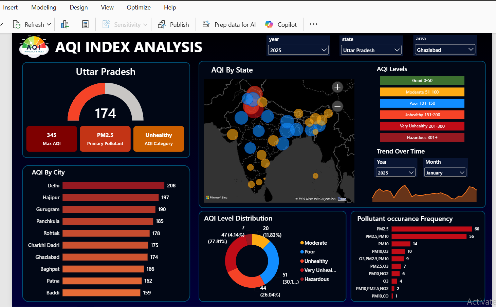

# 🌫️ India Air Quality (AQI) Analysis — Interactive Power BI Dashboard

> An end-to-end Power BI project that turns **425K+ daily air-quality readings** across **32 states/UTs and 295 cities** into a single, filterable dashboard for spotting pollution hotspots, seasonal patterns, and dominant pollutants.


<!-- Add a screenshot of the dashboard at images/dashboard.png -->

---

## 📌 Project Overview

| | |
|---|---|
| **Project type** | Business Intelligence / Data Visualization |
| **Role** | Data Analyst (end-to-end: data prep → modeling → DAX → dashboard → insights) |
| **Tools** | Power BI Desktop, Power Query (M), DAX, Excel |
| **Dataset** | Day-wise AQI data — 425,279 records, 1 May 2015 to 19 Jun 2025 |
| **Coverage** | 32 states/UTs · 295 cities/areas |

---

## 🎯 Business Problem

Air pollution is one of India's most serious public-health and economic challenges. Environmental agencies, city administrators, and health-policy teams receive daily AQI readings from hundreds of monitoring stations, but the raw data is large, scattered across locations and years, and hard to interpret quickly.

Decision-makers struggle to answer basic questions:

- Which states and cities are the **most polluted**, and by how much?
- Is air quality **getting better or worse** over time?
- Is pollution **seasonal**, and when should interventions be timed?
- Which **pollutants** are driving poor air quality, so action can be targeted?
- How often do residents face **unhealthy** air days?

Without a consolidated view, interventions are reactive, hotspots are missed, and resources are not prioritised where they matter most.

## 🎯 Objective

Build an interactive, self-service dashboard that lets stakeholders explore AQI data at national, state, and city level, with the goal to:

1. **Identify** the highest- and lowest-AQI states and cities.
2. **Track** AQI trends across years and months to reveal seasonality.
3. **Classify** days into AQI health categories and measure how often each occurs.
4. **Pinpoint** the most frequent prominent pollutants.
5. **Enable** drill-down using slicers for state, city, year, and month.

---

## 🗂️ Dataset

Source file: `day_wise_aqi_data.xlsx` (one row per city per day)

| Column | Description |
|---|---|
| `date` | Date of the reading |
| `state`, `area` | State/UT and city/area |
| `number_of_monitoring_stations` | Stations reporting for that area and day |
| `prominent_pollutants` | Main pollutant(s) driving the AQI (PM10, PM2.5, O3, CO, NO2, SO2) |
| `aqi_value` | Air Quality Index (0–500) |
| `air_quality_status` | Status label reported in the source data |

---

## ⚙️ Approach

**1. Data preparation (Power Query)**
- Imported the Excel source, promoted headers, and set correct data types (dates, integers, text).

**2. Data modeling**
- Created a dedicated **Calendar Table** with DAX (`CALENDAR(MIN(date), MAX(date))`) with Year and Month fields, related to the fact table for time intelligence.
- Added calculated columns: `AQI Category`, `AQI Level`, and `AQI Category number` to group readings into health bands.

**3. DAX measures**
- `AVG AQI` — average AQI for the current filter context.
- `AQI Category KPI` — dynamically maps the average AQI to a category label.
- `Primary Pollutant` — dynamically returns the most frequent pollutant for the current selection (handles ties).
- `Count Of Rows` — record count used for distribution visuals.
- Dynamic title measures (e.g. selected state shown in the header) for a cleaner user experience.

```DAX
Primary Pollutant =
VAR PollutantTable =
    SUMMARIZE (
        day_wise_aqi_data,
        day_wise_aqi_data[prominent_pollutants],
        "PollutantCnt", COUNTROWS ( day_wise_aqi_data )
    )
VAR MaxCnt = MAXX ( PollutantTable, [PollutantCnt] )
RETURN
    CONCATENATEX (
        FILTER ( PollutantTable, [PollutantCnt] = MaxCnt ),
        day_wise_aqi_data[prominent_pollutants],
        ", "
    )
```

```DAX
AQI Category KPI =
VAR AvgAQI = AVERAGE ( day_wise_aqi_data[aqi_value] )
RETURN
    SWITCH (
        TRUE (),
        AvgAQI <= 50,  "Good",
        AvgAQI <= 100, "Moderate",
        AvgAQI <= 150, "Poor",
        AvgAQI <= 200, "Unhealthy",
        AvgAQI <= 300, "Very Unhealthy",
        AvgAQI > 300,  "Hazardous",
        "NA"
    )
```

**4. Dashboard design**

| Visual | Purpose |
|---|---|
| Gauge + KPI cards | Average AQI, its category, and the primary pollutant for the current selection |
| Map | AQI by state (bubble size = average AQI) |
| Bar chart | AQI by city, ranked |
| Donut chart | AQI level distribution (share of days per category) |
| Bar chart | Pollutant occurrence frequency |
| Area chart | AQI trend over time |
| Slicers | State, City, Year, Month |

---

## 🔍 Key Insights

- **Scale:** The analysis covers 425,279 daily records; the overall average AQI is **~119**.
- **Hotspots:** **Delhi** has the highest state-level average AQI (**~216**), followed by **Bihar (~166)**, **Himachal Pradesh (~160)**, **Uttar Pradesh (~160)**, and **Haryana (~152)**. At city level, **Gurgaon (~223)**, **Delhi (~216)**, and **Ghaziabad (~213)** lead (cities with at least a year of data).
- **Cleanest regions:** **Mizoram (~45)**, **Meghalaya (~53)**, and **Sikkim (~54)** record the lowest averages; the cleanest city is **Aizawl**.
- **Strong seasonality:** AQI peaks in winter, with monthly averages of **~174 in November**, **~168 in December**, and **~163 in January**, compared with just **~66 in August**, roughly a **2.6x** swing.
- **Health impact:** About **25% of readings fall in the Unhealthy or worse bands (AQI > 150)**, and only **~16%** are in the Good band.
- **Dominant pollutants:** **PM10** is the sole prominent pollutant in about **44%** of records and **PM2.5** in about **28%**. PM2.5-driven days carry the highest average AQI (**~178**), so particulate matter is the core problem.
- **Trend:** Average AQI has declined from **~157 (2015–16)** to **~105 (2024)**. This should be read with care, as the number of monitored cities grew from 22 to 281 over the same period and 2025 is a partial year.

---

## ✅ Conclusion

Air quality in India is a **regional and seasonal problem, driven mainly by particulate matter**. The northern Indo-Gangetic belt (Delhi-NCR, Uttar Pradesh, Haryana, Bihar) carries the heaviest burden, and pollution intensifies sharply in the **October–January** window, while coastal, southern, and north-eastern regions remain comparatively clean.

Because **PM10 and PM2.5** account for the bulk of pollution days, the most effective interventions are those aimed at particulates: dust control, construction and road-dust management, vehicular and industrial emission norms, and crop-residue burning.

**Recommendations**
1. **Prioritise hotspot cities** (Gurgaon, Delhi, Ghaziabad, Greater Noida, Faridabad, Bhiwadi) for stricter enforcement and monitoring.
2. **Time interventions seasonally**, with action plans and public advisories launched ahead of October rather than after the spike begins.
3. **Target particulate sources** (PM10 / PM2.5) as the highest-impact lever.
4. **Expand monitoring** in states with sparse coverage so that regional comparisons become more reliable.
5. **Use the dashboard routinely** for tracking progress against pollution-control targets.

---

## ⚠️ Limitations

- Monitoring coverage expanded significantly over the years, so long-term trend comparisons are indicative rather than like-for-like.
- 2025 data runs only until 19 June, so it is a partial year.
- Some records are missing the monitoring-station count (141 rows).
- Averages weight every reading equally and do not adjust for the number of stations or population exposed.

## 🚀 Future Enhancements

- Add year-over-year and month-over-month change measures.
- Include population-weighted exposure and health-risk metrics.
- Add forecasting for seasonal AQI peaks.
- Automate the data refresh from a live source.

---

## 🛠️ How to Use

1. Clone or download this repository.
2. Open `AQI_INDEX_ANALYSIS.pbix` in **Power BI Desktop**.
3. If prompted, update the data source path to your local copy of `day_wise_aqi_data.xlsx` (*Transform data → Data source settings*).
4. Use the slicers (State, City, Year, Month) to explore.

## 📁 Repository Structure

```
├── AQI_INDEX_ANALYSIS.pbix     # Power BI report
├── day_wise_aqi_data.xlsx      # Source data
├── images/
│   └── dashboard.png           # Dashboard screenshot
└── README.md
```

---

## 👤 Author

**Kasim**
B.Tech Computer Science Engineering | Aspiring Data Analyst
🔗 [LinkedIn](https://linkedin.com/in/kasim-abbasi-889b61308) · 💻 [GitHub](https://github.com/kasim-01)

*Skills demonstrated: SQL · Excel · Python · Power BI · DAX · Power Query · Data Modeling · Data Storytelling*
