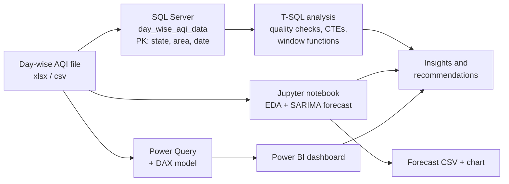
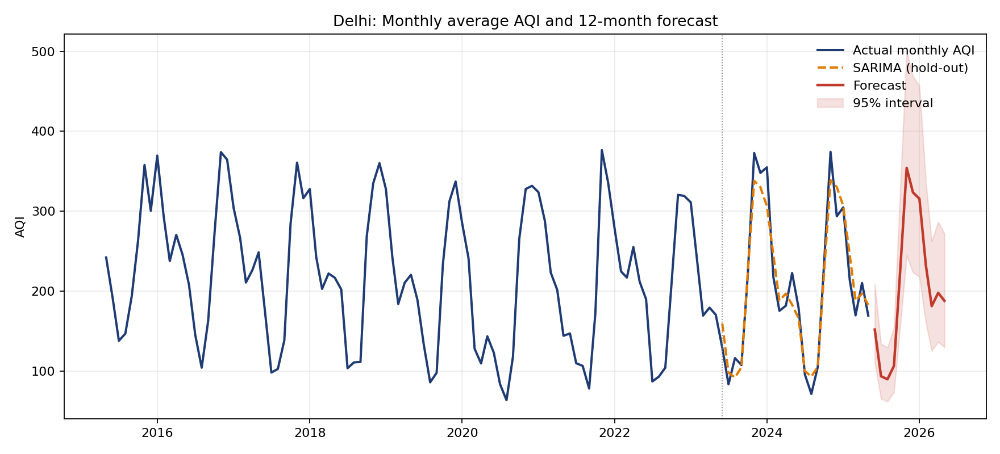

# 🌫️ India Air Quality (AQI) Analytics: SQL Server · Python · Power BI

> An end-to-end analytics project on **425,279 daily air-quality readings** from **295 cities in 32 states/UTs (May 2015 – Jun 2025)**. It covers data engineering in SQL Server, exploratory analysis and time-series forecasting in Python, and an interactive Power BI dashboard for decision-makers.


<!-- Add screenshot: images/dashboard.png -->

---

## Table of Contents
1. [Executive Summary](#1-executive-summary)
2. [Business Problem](#2-business-problem)
3. [Objectives and Key Questions](#3-objectives-and-key-questions)
4. [Solution Architecture](#4-solution-architecture)
5. [Dataset and Data Quality](#5-dataset-and-data-quality)
6. [Data Engineering (SQL Server)](#6-data-engineering-sql-server)
7. [SQL Analysis](#7-sql-analysis)
8. [Power BI Dashboard](#8-power-bi-dashboard)
9. [Python: EDA and Forecasting](#9-python-eda-and-forecasting)
10. [Key Insights](#10-key-insights)
11. [Conclusion and Recommendations](#11-conclusion-and-recommendations)
12. [Limitations and Threats to Validity](#12-limitations-and-threats-to-validity)
13. [How to Reproduce](#13-how-to-reproduce)
14. [Repository Structure](#14-repository-structure)
15. [Future Work](#15-future-work)
16. [Author](#16-author)

---

## 1. Executive Summary

| | |
|---|---|
| **Scope** | 425,279 daily records · 295 cities · 32 states/UTs · 1 May 2015 to 19 Jun 2025 |
| **Stack** | SQL Server (T-SQL), Python (pandas, statsmodels, matplotlib), Power BI (DAX, Power Query), Jupyter |
| **Headline finding** | Air pollution is regional, seasonal and particulate-driven. Delhi-NCR carries the heaviest burden, and AQI averages about **174 in November vs about 66 in August**. |
| **Fair trend** | Across the **same 112 cities** reporting every year, average AQI fell from **134.5 (2019) to 112.2 (2024)**. |
| **Forecast** | SARIMA reproduces Delhi's seasonal cycle with about **10% average error** on a 24-month hold-out, but beats a simple seasonal baseline only modestly. |

---

## 2. Business Problem

Air pollution is one of India's most serious public-health and economic challenges. Environmental agencies, city administrators and health-policy teams receive daily AQI readings from hundreds of monitoring stations. The raw data is large, spread across locations and years, and hard to interpret quickly.

Decision-makers cannot easily answer:

- Which states and cities are the **most polluted**, and by how much?
- Is air quality **improving**, and is that comparison fair given how fast monitoring expanded?
- When is pollution **worst**, so that interventions can be timed ahead of the peak?
- Which **pollutants** drive poor air quality, so action can be targeted?
- How often do residents face **unhealthy** air?

Without a consolidated, trustworthy view, interventions are reactive, hotspots are missed, and resources are not prioritised where they matter most.

## 3. Objectives and Key Questions

| # | Objective | Delivered by |
|---|---|---|
| 1 | Build a clean, queryable data foundation | SQL Server table with enforced primary key and quality checks |
| 2 | Identify the most and least polluted states and cities | SQL + Power BI map and ranked bar chart |
| 3 | Measure seasonality and AQI category distribution | SQL, Power BI donut and trend charts |
| 4 | Determine the dominant pollutants | SQL + dynamic DAX measure |
| 5 | Measure the trend fairly, correcting for coverage growth | Like-for-like city cohort (SQL and Python) |
| 6 | Forecast the seasonal cycle to support planning | SARIMA model validated against a baseline |
| 7 | Give stakeholders self-service exploration | Power BI slicers (State, City, Year, Month) |

---

## 4. Solution Architecture



---

## 5. Dataset and Data Quality

**Source file:** `day_wise_aqi_data.xlsx` / `.csv` (one row per city per day).

| Column | Type | Description |
|---|---|---|
| `date` | date | Date of reading |
| `state` | text | State or union territory |
| `area` | text | City/area |
| `number_of_monitoring_stations` | int | Stations reporting for that area and day |
| `prominent_pollutants` | text | Main pollutant(s): PM10, PM2.5, O3, CO, NO2, SO2 (combinations possible, e.g. `PM2.5,PM10`) |
| `aqi_value` | int | Air Quality Index, 0 to 500 |
| `air_quality_status` | text | Status label from the source |

### Data-quality findings (found and handled)

| Finding | Impact | How it was handled |
|---|---|---|
| **141 rows have no station count** | Nulls in `number_of_monitoring_stations` | Column kept nullable; not used in averages |
| **Two cities are both named "Aurangabad"** (Bihar and Maharashtra) | Grouping by `area` alone shows 820 false duplicates and merges two cities | Every city-level query groups by **state + area**; composite primary key `(state, area, date)` |
| **Monitoring coverage grew from 22 cities (2015) to 280+ (2024)** | Raw yearly averages are not comparable | Like-for-like cohort of 112 cities present in every year 2019 to 2024 |
| **Uneven state coverage** (e.g. Assam has no data before Feb 2019) | Some State + Year selections are legitimately empty | Documented; not imputed |
| **2025 is a partial year** (to 19 Jun) | Misleading year totals | Excluded from trend comparisons |
| **Values with commas in text** (`"PM2.5,NO2"`) | Breaks naive CSV parsing | Quoted-field aware import (`FORMAT='CSV'`, `FIELDQUOTE`) |
| **AQI range check** | Values outside 0 to 500 | None found (min 3, max 500) |

---

## 6. Data Engineering (SQL Server)

The data was loaded into SQL Server with an enforced composite primary key and correctly sized types.

```sql
CREATE TABLE dbo.day_wise_aqi_data (
    [date]                          DATE         NOT NULL,
    state                           NVARCHAR(50) NOT NULL,
    area                            NVARCHAR(50) NOT NULL,
    number_of_monitoring_stations   TINYINT      NULL,       -- 141 empty values
    prominent_pollutants            NVARCHAR(50) NOT NULL,
    aqi_value                       INT          NOT NULL,   -- NOT tinyint: AQI reaches 500
    air_quality_status              NVARCHAR(50) NOT NULL,
    CONSTRAINT pk_day_wise_aqi PRIMARY KEY (state, area, [date])
);

BULK INSERT dbo.day_wise_aqi_data
FROM 'C:\data\day_wise_aqi_data.csv'
WITH (FORMAT = 'CSV', FIELDQUOTE = '"', FIRSTROW = 2, ROWTERMINATOR = '0x0a', KEEPNULLS, TABLOCK);
```

**Design decisions**
- **Composite primary key `(state, area, date)`:** the natural key. Verified to have zero duplicates across all 425,279 rows, and it also stops the same reading being loaded twice.
- **`aqi_value` as `INT`:** the Import Flat File wizard suggests `tinyint` (0 to 255), which would fail or lose data because 33,204 rows exceed 255.
- **Station count stays nullable:** 141 empty values would otherwise abort the load.

**Load validation**

```sql
SELECT COUNT(*) AS total_rows, MIN([date]) AS first_date, MAX([date]) AS last_date, MAX(aqi_value) AS max_aqi
FROM dbo.day_wise_aqi_data;
-- Expected: 425279 | 2015-05-01 | 2025-06-19 | 500
```

---

## 7. SQL Analysis

`aqi_sql_analysis_tsql.sql` (SQL Server) contains **17 queries**. A functionally equivalent ANSI version for MySQL 8 / PostgreSQL is in `aqi_sql_analysis.sql`.

| Section | What it covers |
|---|---|
| **Data quality** | Row counts, nulls, duplicates by state + area + date, out-of-range AQI, coverage growth |
| **Core analysis** | Top states and cities, monthly seasonality, AQI category shares, pollutant frequency |
| **Advanced SQL** | `RANK` within state, `LAG` year-over-year change, `ROW_NUMBER` worst month per state, 30-day moving average, conditional aggregation for winter-vs-monsoon gap |

**Example: fair national trend (same cities every year)**

```sql
WITH yearly AS (
    SELECT state, area, YEAR([date]) AS yr, AVG(aqi_value * 1.0) AS avg_aqi
    FROM dbo.day_wise_aqi_data
    WHERE YEAR([date]) BETWEEN 2019 AND 2024
    GROUP BY state, area, YEAR([date])
),
consistent_cities AS (
    SELECT state, area FROM yearly GROUP BY state, area HAVING COUNT(*) = 6
)
SELECT y.yr, COUNT(*) AS cities, ROUND(AVG(y.avg_aqi), 1) AS avg_aqi
FROM yearly y
JOIN consistent_cities c ON c.state = y.state AND c.area = y.area
GROUP BY y.yr
ORDER BY y.yr;
```

| Year | Cities | Avg AQI |
|---|---|---|
| 2019 | 112 | 134.5 |
| 2020 | 112 | 117.4 |
| 2021 | 112 | 127.7 |
| 2022 | 112 | 125.7 |
| 2023 | 112 | 120.5 |
| 2024 | 112 | 112.2 |

> **T-SQL detail:** `AVG()` on an `INT` column returns an `INT` in SQL Server and silently truncates decimals, so AQI is multiplied by `1.0` before averaging.

---

## 8. Power BI Dashboard

**Data model:** the fact table `day_wise_aqi_data` plus a DAX-generated **Calendar Table** (`CALENDAR(MIN(date), MAX(date))`) with Year and Month fields.

**Calculated columns:** `AQI Category`, `AQI Level`, `AQI Category number`.

| AQI range | Category | AQI range | Category |
|---|---|---|---|
| 0 to 50 | Good | 151 to 200 | Unhealthy |
| 51 to 100 | Moderate | 201 to 300 | Very Unhealthy |
| 101 to 150 | Poor | 301+ | Hazardous |

**Key measures**

```DAX
AVG AQI = AVERAGE ( day_wise_aqi_data[aqi_value] )

AQI Category KPI =
VAR AvgAQI = AVERAGE ( day_wise_aqi_data[aqi_value] )
RETURN
    SWITCH (
        TRUE (),
        AvgAQI <= 50,  "Good",
        AvgAQI <= 100, "Moderate",
        AvgAQI <= 150, "Poor",
        AvgAQI <= 200, "Unhealthy",
        AvgAQI <= 300, "Very Unhealthy",
        AvgAQI > 300,  "Hazardous",
        "NA"
    )

Primary Pollutant =
VAR PollutantTable =
    SUMMARIZE (
        day_wise_aqi_data,
        day_wise_aqi_data[prominent_pollutants],
        "PollutantCnt", COUNTROWS ( day_wise_aqi_data )
    )
VAR MaxCnt = MAXX ( PollutantTable, [PollutantCnt] )
RETURN
    CONCATENATEX (
        FILTER ( PollutantTable, [PollutantCnt] = MaxCnt ),
        day_wise_aqi_data[prominent_pollutants],
        ", "
    )
```

**Dashboard components**

| Visual | Purpose |
|---|---|
| Gauge + KPI cards | Average AQI, its health category and the primary pollutant for the current selection |
| Map | AQI by state (bubble size = average AQI) |
| Bar chart | Cities ranked by average AQI |
| Donut chart | Share of readings per AQI category |
| Bar chart | Pollutant occurrence frequency |
| Area chart | AQI trend over time |
| Slicers | State, City, Year, Month for drill-down |

**Design notes**
- Dynamic title and KPI measures respond to every slicer selection.
- Slicers are dark-themed to match the page; some State + Year combinations are intentionally empty because of uneven monitoring coverage (see section 5).
- The forecast is produced in Python (section 9) and is not part of the dashboard.

---

## 9. Python: EDA and Forecasting

Notebook: `AQI_Analysis.ipynb` (script version: `aqi_forecast.py`).

### Exploratory analysis
Data-quality checks, top states and cities, monthly seasonality, AQI category shares, pollutant frequency, and the like-for-like trend.

### Forecasting Delhi's monthly AQI

**Why Delhi:** it is the one major city with complete daily data from May 2015 to June 2025 (121 complete months), so its series is not distorted by network expansion.

**Method**
1. Aggregate daily readings to monthly averages.
2. Hold out the last **24 months** for evaluation.
3. Benchmark a **seasonal-naive baseline** ("same month last year") against **SARIMA**, fitted on log-AQI with the order selected by AIC. Selected model: **SARIMA(1,0,0)(0,1,1)₁₂**.
4. Refit on all data and forecast 12 months ahead with 95% prediction intervals (capped at the AQI maximum of 500).

**Hold-out accuracy (last 24 months)**

| Model | MAE | RMSE | MAPE |
|---|---|---|---|
| Seasonal naive | 21.3 | 28.3 | 10.7% |
| SARIMA | 19.7 | 23.6 | 10.4% |



**Interpretation**
- Delhi's AQI is dominated by a stable annual cycle, and the model captures it with about 10% average error.
- SARIMA beats the baseline only modestly, which shows how much of the signal is plain seasonality. Honest model comparison matters more than a headline accuracy number.
- The forecast peaks at about **354 in November** with a wide 95% interval (about 245 to 500), so winter uncertainty is large.
- The data ends in June 2025, so the forecast window (Jun 2025 to May 2026) can be checked against newer data when it becomes available.

---

## 10. Key Insights

| Theme | Finding |
|---|---|
| **State hotspots** | Delhi (about 216) leads, then Bihar (about 166), Himachal Pradesh (about 160), Uttar Pradesh (about 160) and Haryana (about 152) |
| **City hotspots** (at least 1 year of data) | Gurgaon (about 223), Delhi (about 216), Ghaziabad (about 213), Darbhanga (about 208), Greater Noida (about 206), Bhiwadi (about 206) |
| **Cleanest** | Mizoram (about 45), Meghalaya (about 53) and Sikkim (about 54) |
| **Seasonality** | About 174 in November and 168 in December vs about 66 in August, a **2.6x swing**. Delhi's worst month averages about 351 |
| **Health burden** | Good 16.4% · Moderate 36.5% · Poor 21.5% · Unhealthy 11.0% · Very Unhealthy 10.3% · Hazardous 4.2%. About **25% of readings are Unhealthy or worse** |
| **Extreme days** | Hazardous (AQI > 300) share: Gurgaon 29.1%, Darbhanga 28.0%, Ghaziabad 23.6%, Delhi 23.5% |
| **Pollutants** | PM10 alone drives 43.9% of readings and PM2.5 alone 28.2%. PM2.5-driven days have the highest average AQI (about 178) |
| **Fair trend** | Same 112 cities: **134.5 (2019) to 112.2 (2024)**, with a rebound in 2021. The analysis does not establish the cause |

---

## 11. Conclusion and Recommendations

Air quality in India is a **regional, seasonal and particulate-driven problem**. The northern Indo-Gangetic belt (Delhi-NCR, Uttar Pradesh, Haryana, Bihar) carries the heaviest burden, pollution intensifies sharply from **October to January**, and **PM10 and PM2.5** account for the bulk of poor-air days. Coastal, southern and north-eastern regions remain comparatively clean. On a fair like-for-like basis, air quality has improved modestly since 2019, but the winter peaks remain severe.

**Recommendations**
1. **Prioritise hotspot cities** (Gurgaon, Delhi, Ghaziabad, Greater Noida, Bhiwadi, Darbhanga) for stricter enforcement and monitoring.
2. **Time interventions seasonally:** launch action plans and public advisories before October, not after the spike begins.
3. **Target particulates:** dust control, construction and road-dust management, vehicle and industrial emission norms, and crop-residue burning.
4. **Expand monitoring** in states with thin or late coverage so regional comparisons become reliable.
5. **Track progress with like-for-like cohorts**, not raw national averages, to avoid being misled by expanding coverage.

---

## 12. Limitations and Threats to Validity

- **Coverage bias:** monitoring expanded dramatically, so raw averages are not comparable across years. The 112-city cohort mitigates this but represents cities with long-running monitoring, which may not be nationally representative.
- **Correlation, not causation:** the downward trend is not attributed to any policy or event.
- **Single-city, univariate forecast:** it uses AQI history only, with no weather, traffic or policy inputs, and it cannot anticipate unusual events. The winter prediction interval is wide.
- **Averages weight all readings equally** and ignore population exposure and station counts.
- **Partial 2025 data** (to 19 June).
- **Station counts missing** for 141 rows.
- **Category scheme:** the dashboard uses EPA-style AQI bands, while the source's `air_quality_status` column uses India's CPCB labels (Satisfactory, Moderate, Poor, Very Poor, Severe). The two are not interchangeable.

---

## 13. How to Reproduce

**SQL Server**
1. Create the database and table from section 6 (or the setup block in `aqi_sql_analysis_tsql.sql`).
2. Load `day_wise_aqi_data.csv` with `BULK INSERT` (or the Import Flat File wizard, setting `aqi_value` to `int` and allowing nulls for the station count).
3. Run `aqi_sql_analysis_tsql.sql` in SSMS.

**Python**
```bash
pip install pandas numpy matplotlib statsmodels
jupyter notebook AQI_Analysis.ipynb      # Kernel -> Restart & Run All
# or:  python aqi_forecast.py
```
Outputs: `forecast_delhi.csv`, `forecast_delhi.png`.

**Power BI**
1. Open `AQI_INDEX_ANALYSIS.pbix` in Power BI Desktop.
2. If prompted, repoint the data source to your local `day_wise_aqi_data.xlsx`.
3. Clear all slicers to see the national view.

---

## 14. Repository Structure

```
├── AQI_INDEX_ANALYSIS.pbix       # Power BI report
├── AQI_Analysis.ipynb            # EDA, like-for-like trend, SARIMA forecast
├── aqi_forecast.py               # Forecast script version
├── aqi_sql_analysis_tsql.sql     # 17 queries for SQL Server
├── aqi_sql_analysis.sql          # Same queries for MySQL 8 / PostgreSQL
├── day_wise_aqi_data.csv         # Data used by SQL and Python
├── day_wise_aqi_data.xlsx        # Original source file
├── forecast_delhi.csv            # 12-month forecast output
├── images/
│   ├── dashboard.png
│   └── forecast_delhi.png
└── README.md
```

## 15. Future Work

- Add weather variables (temperature, wind speed, rainfall) as forecast predictors and extend to more cities.
- Load the forecast into Power BI as a dashboard page with prediction bands.
- Add population-weighted exposure and health-risk metrics.
- Automate the refresh from a live data source and schedule the forecast.
- Evaluate alternative models (Prophet, gradient boosting) against the SARIMA baseline.

---

## 16. Author

**Kasim**: B.Tech Computer Science Engineering | Aspiring Data Analyst
🔗 [LinkedIn](https://linkedin.com/in/kasim-abbasi-889b61308) · 💻 [GitHub](https://github.com/kasim-01)

*Skills demonstrated: SQL Server (T-SQL, CTEs, window functions, constraints) · Python (pandas, statsmodels) · Time-series forecasting · Power BI · DAX · Power Query · Data modeling · Data quality · Data storytelling*
